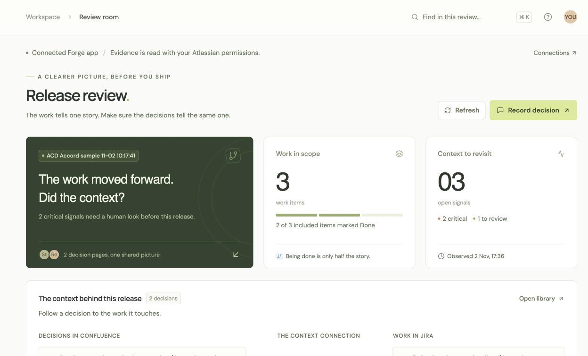
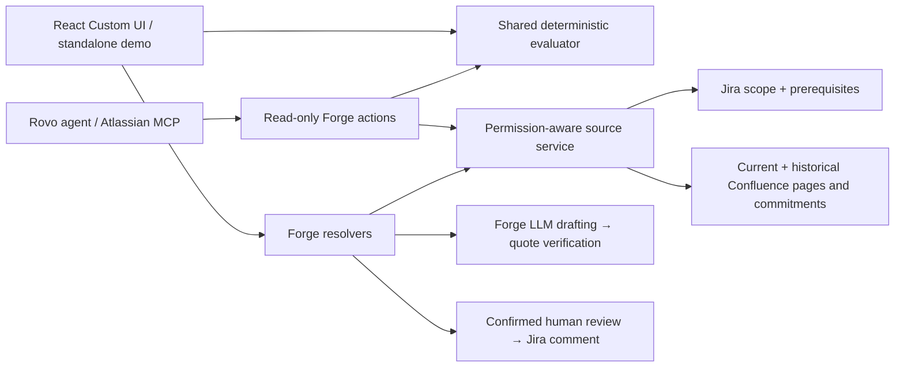

# Accord

**Keep the why with the work.**



Accord is a release review app for Jira and Confluence. It catches the moment a
decision moves on after the work built on it is already **Done**.

A security page said _"Refresh tokens rotate every 24 hours."_ The session flow
was built to that and closed. Two days later the page says _"rotate on every use,
and reusing an old token revokes the whole session."_ Jira still shows a green
release. Accord shows:

> **PLAT-142 was built on a commitment that changed.**
> Confirmed in v3: "Refresh tokens rotate every 24 hours." → Now in v4: "…rotate on every use…"

Teams write decisions in plain prose. Accord drafts the commitments with an
Atlassian-hosted model, keeps only those that quote the page word for word, and
lets a human confirm them. From then on every check is deterministic.

## How it works

1. **Write the decision** in Confluence, mentioning the Jira work it governs.
2. **Draft commitments.** Forge LLM proposes commitments; each must quote a
   sentence that exists on the page, or it is discarded with a reason.
3. **Confirm** the ones you agree with. They are stored on the page itself.
4. **Review the release.** Accord compares the reviewed and current page sentence
   by sentence, checks prerequisites, forbidden labels and owners in Jira, and
   names the Done work affected by any change.
5. **Explore a smaller release** in the what-if lab, without touching Jira.
6. **Record the call** as a Jira comment, after a fresh evidence comparison.

A Rovo agent and Atlassian MCP tools use the same read-only actions and the same
evaluator, so an agent can ask "what does this decision commit us to?" or "is
this release still consistent with its decisions?" with the caller's permissions.

## Try it locally

```sh
npm ci
npm run dev
```

Open [localhost:5173](http://localhost:5173). No account, API key or paid model is
needed. The standalone demo is labelled throughout and uses fictional data.

1. In **Review room**, open _PLAT-142 was built on a commitment that changed_.
2. Choose **Compare & review this decision**: see the sentence diff, which
   commitments are still stated, then **Draft commitments** for v4. The demo uses
   a prepared draft and says so; it never calls a model.
3. Try **What-if lab → Find smallest deferral**: deferring PLAT-142 clears both
   critical signals; the missing rollout owner remains.
4. **Record decision**, then inspect **Review history**.

**Settings → Reset demo & history** restores the fixture.

## On Atlassian

Install with the [installation link](docs/install.md) in Jira and Confluence on
the same site. Then open **Jira → Apps → Accord → Settings → Create sample
release**: after your confirmation it creates a labelled release version, five
work items, two prose decision pages with confirmed commitments and one
post-review edit, so the review opens with real drift on your own data. See the
[judge walkthrough](docs/judge-guide.md).

| Capability                           | Local demo       | Forge implementation                                     |
| ------------------------------------ | ---------------- | -------------------------------------------------------- |
| Sentence-level drift and Jira checks | Working          | Current and historical pages read as the caller          |
| Drafting commitments from prose      | Prepared draft   | Forge LLM with forced tool use and quote verification    |
| Confirmed commitments                | Browser storage  | Confluence page property, never copied into Jira         |
| Minimum-cost deferral search         | Weighted fixture | Uniform item cost, up to 15 scope items                  |
| Human decision record                | Browser storage  | Jira comment after a fresh evidence comparison           |
| One-click sample release             | Described        | Creates labelled Jira and Confluence data after consent  |
| Rovo agent, five read-only actions   | Not simulated    | `rovo:agent` + `action`; also exposed through `rovo:mcp` |

**Status, 2 November 2026.** Version 2.x is deployed to production and installed
in Jira and Confluence on two sites; its baseline, diff, what-if, comment and
shared history flows were verified in a browser, and the Rovo agent invoked its
inspect action on a second site (the full happy path is still to be recorded). The 3.x features above (Forge LLM drafting, page
property storage, sentence-level drift, sample release, issue and page surfaces,
Teamwork Graph context) pass unit and adapter tests against mocked Atlassian
APIs. A Forge LLM draft was verified on the development site; the other 3.x
features still need a browser walkthrough there. External MCP
OAuth currently fails before the client callback and is under investigation with
Atlassian. See [verification](docs/verification.md).

## Architecture



The model only proposes. Verification, drift detection, rule evaluation and the
deferral search are plain TypeScript in `src/domain/`, shared by the UI, resolvers
and agent actions. Missing or unreadable evidence is reported as unknown, never as
clear. Accord asks Teamwork Graph, as the user and through curated queries, who
shaped each decision and which goals the affected work contributes to. This only
informs the reviewer and never changes a result. On the development site the
queries are accepted by the API; results with real people and goals are still to
be confirmed. The evidence map in the UI is Accord's own.

## Development

```sh
npm run check          # types, tests, build, local manifest validation
npm run setup:hooks    # Conventional Commits and staged secret/private-file guard
```

Node 22.23.4 is specified in `.nvmrc`; a pinned Node runtime is included as a
development dependency so npm scripts can run Forge CLI 15 on an older host.

- `src/domain/`: schema, sentence diff, draft verification, evaluator, deferral search
- `src/forge/`: product adapters, Forge LLM drafting, sample release, Rovo/MCP actions
- `src/web/`: responsive React interface and clearly separated demo client
- `tests/`: domain tests and adapter tests against mocked Jira and Confluence
- `docs/`: public technical documentation

## Documentation

- [Installation and tenant verification](docs/setup.md)
- [Installation link](docs/install.md)
- [Judge walkthrough](docs/judge-guide.md)
- [Decision commitments](docs/contracts.md)
- [Architecture and permission boundaries](docs/architecture.md)
- [Privacy and retained data](docs/privacy.md)
- [Rovo and MCP tools](docs/agents.md)
- [Verification record and limitations](docs/verification.md)
- [Contribution conventions](docs/contributing.md)

## Scope and limits

Accord checks the decision pages selected for a release and the work visible to
the current user. Sentence comparison is exact after normalising case, whitespace
and typography; it does not judge meaning. A similar replacement sentence is a
hint. A clear result covers only the confirmed commitments and is not deployment
approval. Review records are ordinary Jira comments; the snapshot ID is a label,
not a signature. Refresh-before-write narrows, but cannot eliminate, races between
Jira and Confluence. Accord never changes fixVersions or executes releases.

Built for [Codegeist 2026](https://codegeist2026.devpost.com/). MIT © ZNLong2203.
