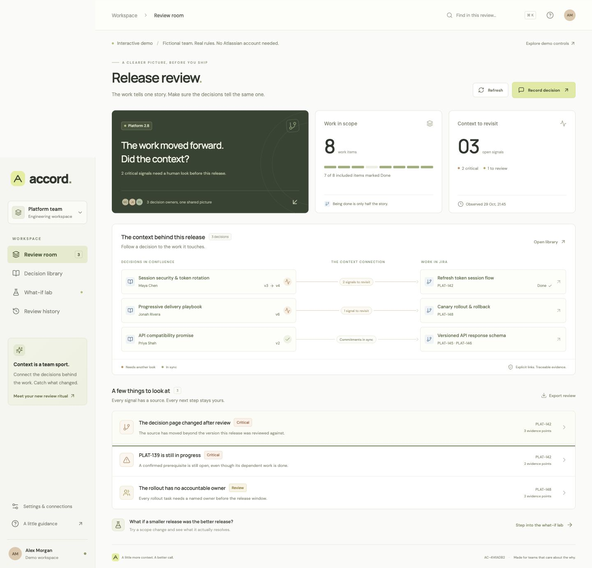
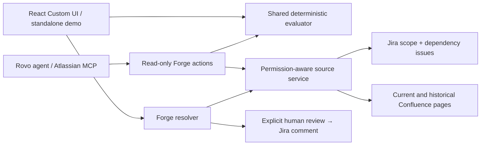

# Accord

**Keep the why with the work.**



Accord is a release review app for Jira and Confluence. It connects explicitly
reviewed decision pages to the work they inform, flags changes and unmet
commitments, and lets a team explore a smaller release before making a human call.

A Jira issue can be **Done** while its decision page has moved on. In the included
scenario, a session flow is finished, its security decision page changed after
review, and a required token-rotation test is still open. Accord traces each signal
to its evidence. Deferring the session flow removes two signals from the
hypothetical scope; it does not complete the test or change Jira.

## Try it locally

```sh
npm ci
npm run dev
```

Open [localhost:5173](http://localhost:5173). No account, API key or paid model is
needed. The standalone demo is labelled throughout and uses fictional data.

1. Open a signal in **Review room** to follow its evidence.
2. Try **What-if lab → Find smallest deferral**. Eight scope items become seven;
   three signals become one. The missing rollout owner remains visible.
3. Return to Review room and choose **Back to current scope**.
4. **Record decision**, explain the call, and confirm the reviewed evidence.
5. Inspect **Review history**, or use **Settings** to change the fictional source
   version, prerequisite status and rollout owner.

The demo persists evidence changes and review records in this browser only.
**Reset demo & history** restores the fixture.

## What is implemented

| Capability                              | Local demo                | Forge implementation                                            |
| --------------------------------------- | ------------------------- | --------------------------------------------------------------- |
| Decision version and commitment checks  | Working                   | Jira/Confluence REST adapters                                   |
| Evidence map, source inspector, library | Working                   | Same Custom UI                                                  |
| Reversible scope scenarios              | Working                   | Same deterministic evaluator                                    |
| Minimum-cost deferral search            | Working, weighted fixture | Uniform item cost; up to 15 scope items                         |
| Human decision record                   | Browser storage           | User-authored Jira comment after fresh evidence comparison      |
| Rovo agent and four read-only actions   | Not simulated             | Declared and implemented; tenant verification pending           |
| Atlassian MCP tools                     | Not simulated             | `rovo:mcp` reuses the four actions; tenant verification pending |

**Deployment status:** local build, unit/adapter tests and Atlassian's installed
manifest validators pass. The app is registered and authenticated `forge lint`
passes. A development deployment and installations in Jira and Confluence have
succeeded on a developer site. An authenticated browser walkthrough verified
baseline setup/re-review, current/historical Confluence reads, prerequisite checks, source
diffs, scope simulation, a confirmed Jira comment and shared history reload.
Restricted-user permissions, Rovo and MCP still need verification. See
[verification](docs/verification.md) and the
[reproducible tenant demo](docs/live-demo.md).

## Review the change, not just the warning

Use **Compare & review this decision** from an edited source. Accord shows source
excerpts and explicit contract fields before and after, including added/removed
commitments and applicability changes. A confirmed re-review adopts only that
page's current version; other prerequisite and owner signals remain open.

**Settings → Build a decision contract** provides editable templates, a validated
JSON preview, copy/download, and a local demo-library action. No Confluence page
is created without a real tenant. Teams still confirm the meaning of each rule.

Live **Review history** reads paginated Jira comments and their structured Accord
metadata as the current user. A retry identifier recovers an already recorded
comment after an ambiguous response; concurrent requests are not guaranteed
exactly-once. `npm run doctor` explains which tenant prerequisites remain.

## Architecture



The graph displayed by Accord is an explicit evidence map. It is **not** an
Atlassian Teamwork Graph API integration. The deterministic core does not call an
LLM. A deployed Rovo agent can explain its tool results using Atlassian's agent
platform; it cannot write decisions or approve a deployment.

## Development

```sh
npm run check          # types, tests, build, local manifest validation
npm run setup:hooks    # Conventional Commits and staged secret/private-file guard
```

Node 22.23.4 is specified in `.nvmrc`. A pinned local Node runtime is also included
as a development dependency so npm scripts can run Forge CLI 15 on an older host
Node. The host must be able to run npm and install that runtime. `package-lock.json`
pins the dependency tree. All fonts are bundled; the UI has no external font or
model calls.

- `src/domain/`: contracts, rules, counterfactual search, review evidence
- `src/forge/`: authenticated product adapters, resolvers, Rovo/MCP actions
- `src/web/`: responsive React interface and clearly separated demo client
- `tests/`: domain and mocked product-adapter tests
- `docs/`: public technical documentation

## Documentation

- [Installation and tenant verification](docs/setup.md)
- [Architecture and permission boundaries](docs/architecture.md)
- [Privacy and retained data](docs/privacy.md)
- [Explicit decision contracts](docs/contracts.md)
- [Rovo and MCP tools](docs/agents.md)
- [Verification record and limitations](docs/verification.md)
- [Contribution conventions](docs/contributing.md)

## Scope and limits

Checks cover selected decision pages and work visible to the current user. A
changed page version means **review needed**, including for a spelling edit; it
does not prove a semantic contradiction. Rules come from explicitly adopted JSON
contracts, not arbitrary natural-language decisions. Missing evidence is unknown.
A clear result only describes the selected rules, and is not deployment approval.

Review records are ordinary Jira comments. The short snapshot ID is a label,
not a digital signature. Refresh-before-write reduces stale reviews but cannot
make Jira and Confluence updates atomic. The app neither changes fixVersions nor
executes releases. See [architecture](docs/architecture.md) for details.

Built for [Codegeist 2026](https://codegeist2026.devpost.com/). MIT © ZNLong2203.
